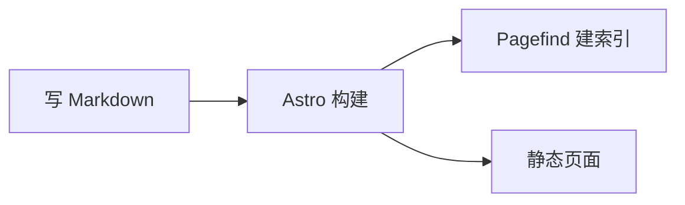

:::note
这是一篇示例文章，用来检查正文排版：标题、引用、代码块、提示块、表格、公式、图表，以及注音、黑幕、高亮这几种小语法。
:::

用了快一年的 Firefly，终于决定搬家。原因不复杂：它很好看，但每次打开后台改配置，都像在别人家里挪家具。这次想要一个从骨架到配色都是自己定的地方。

## 为什么要自己写

现成的主题解决的是「快速有一个好看的博客」。我现在的问题换成了「这个博客要像我」，这两件事需要的东西不一样。

> 好看的主题很多，住久了还是会想要一间自己的屋子。
>
> —— 写在搬家之前

### 想留下的

- 页面切换时的连贯感，从列表点进文章不会「闪一下」
- 斜切封面那种一眼就能认出来的节奏
- 夜里切到深色时，粉色不刺眼，:mark[仍然像晚上的樱花]

### 想丢掉的

- 用不上的功能页和它们带来的配置项
- 一层套一层、改一个颜色要找三个文件的样式结构

## 技术选型

选型的原则是：能交给成熟库的就交给库，和外观有关的部分自己写。

| 部分 | 选择 | 理由 |
| --- | --- | --- |
| 框架 | Astro 7 | 静态输出，内容集合自带类型校验 |
| 样式 | 原生 CSS | OKLCH token 加 `@layer`，主题包里不依赖 Tailwind |
| 交互 | Svelte 5 | 只用在搜索这种有状态的小部件 |
| 搜索 | Pagefind | 构建时建索引，不需要后端 |

```js title="astro.config.mjs"
import { defineConfig } from 'astro/config';
import yoakari from 'astro-yoakari';

export default defineConfig({
  site: 'https://example.com',
  // 主题以集成的形式装进来，文章留在站点自己的仓库
  integrations: [yoakari({ title: '雪見の小屋', author: { name: 'Yukimi' } })],
});
```

## 视觉方向

主色定在偏暖的樱粉，深色模式不是简单反色，而是换成:ruby[夜桜]{rt="よざくら"}的感觉：底色带一点紫，粉色提亮、降低饱和。其实最开始想做成:spoiler[纯黑配荧光粉]，试了一晚上就放弃了。

> [!TIP]
> 主题色只定一个色相，其余颜色都从它推出来。换色时整站一起变，不会出现某个按钮还是旧颜色。

颜色的感知亮度用 OKLCH 的 $L$ 表示，两种颜色的对比度按 WCAG 计算：

$$
\text{contrast} = \frac{L_1 + 0.05}{L_2 + 0.05}
$$



阅读体验上，正文限制在七十个字符左右的宽度，行高放宽到 1.95。按 <kbd>/</kbd> 可以直接打开搜索。时间写成 10:30 这样也不会被误认成语法。

## 接下来

1. 定内容模型：frontmatter 字段、永久链接、要支持的扩展语法
2. 搭骨架，先让文章能正常渲染出来
3. 接上后台，在浏览器里写下一篇

:::warning[注意]
示例里的封面是生成的渐变图。正式站换成插画就行，构建时会自动压缩成多种尺寸。
:::
